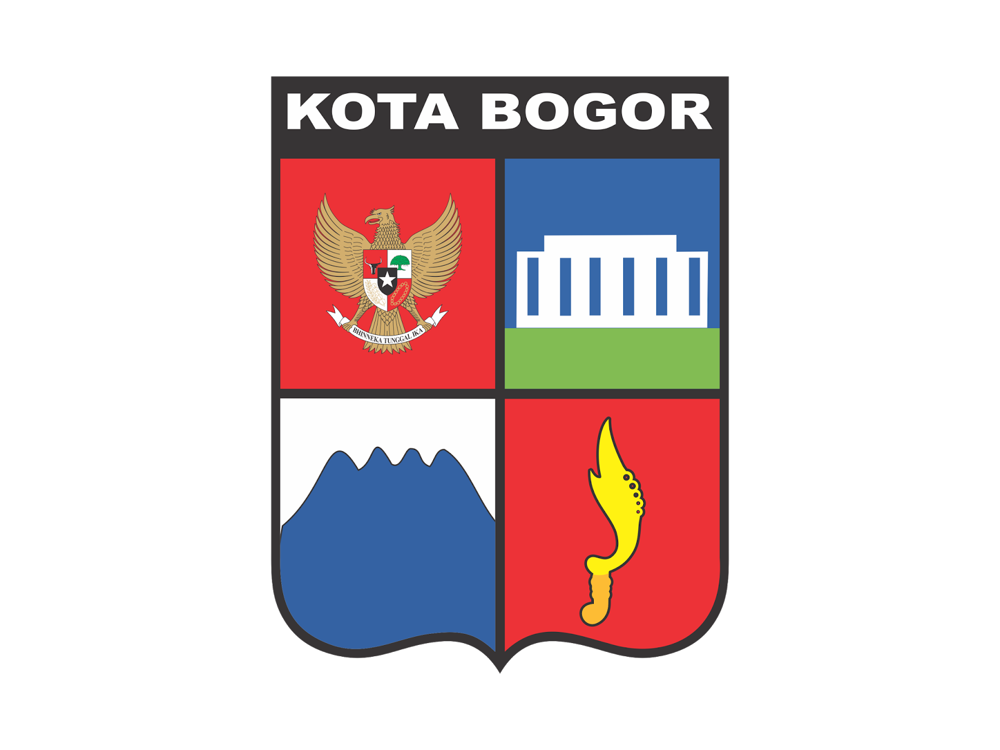
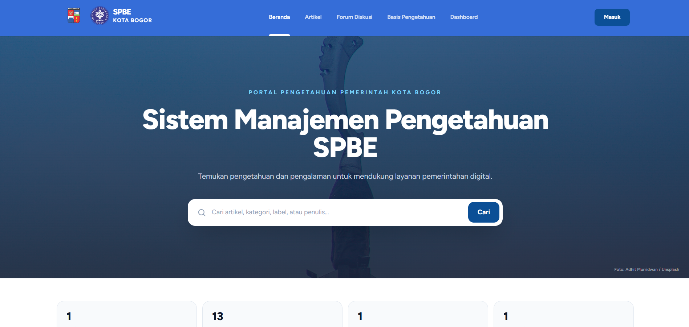
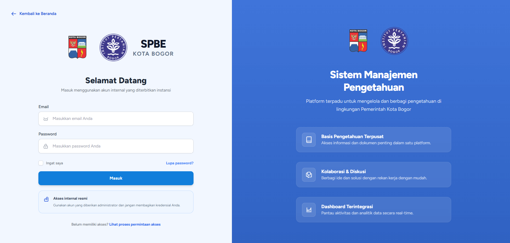
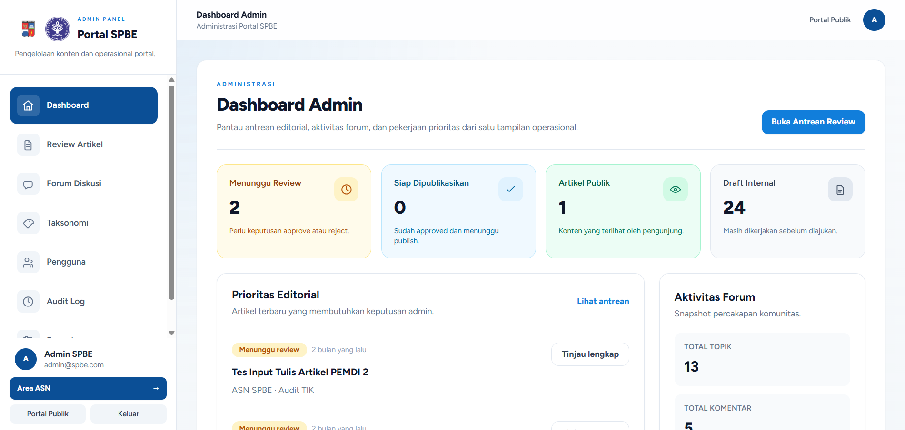
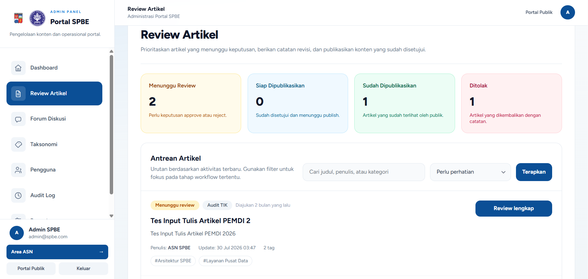
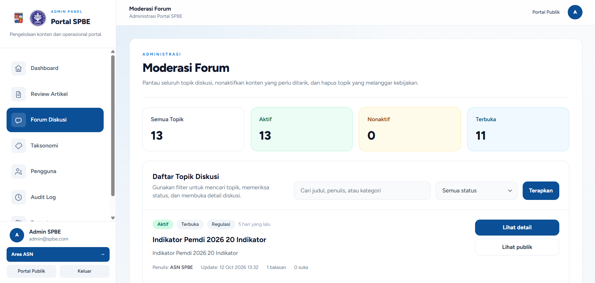
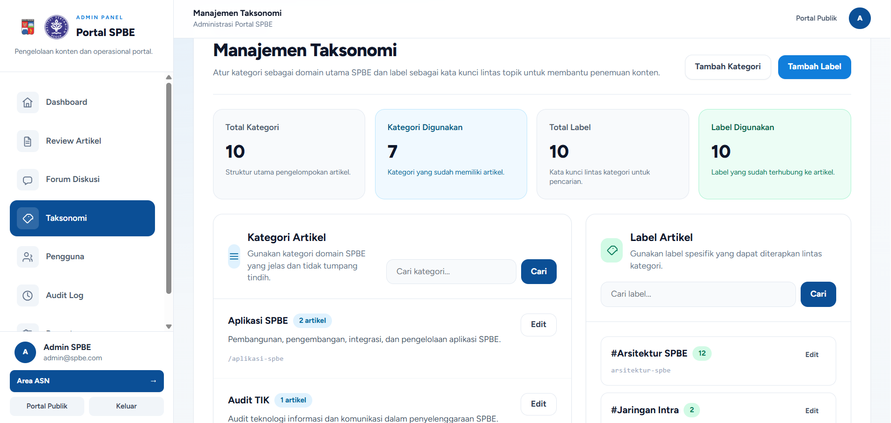
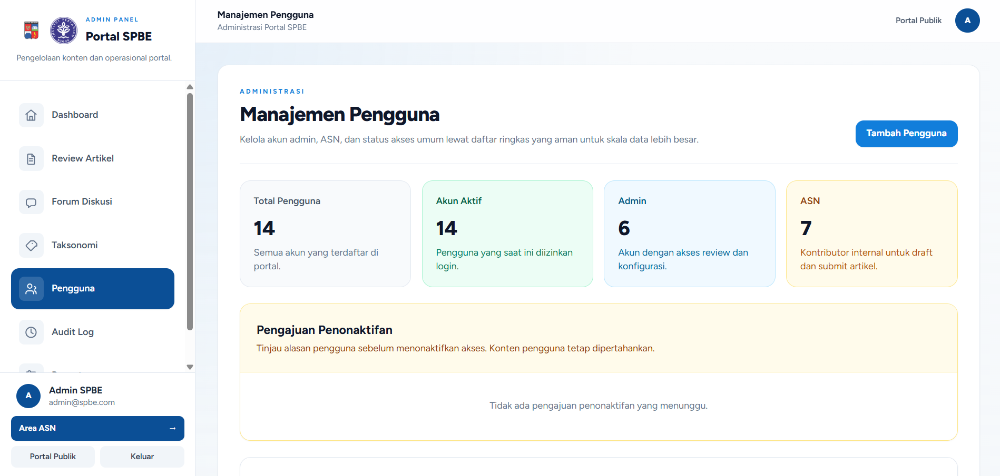
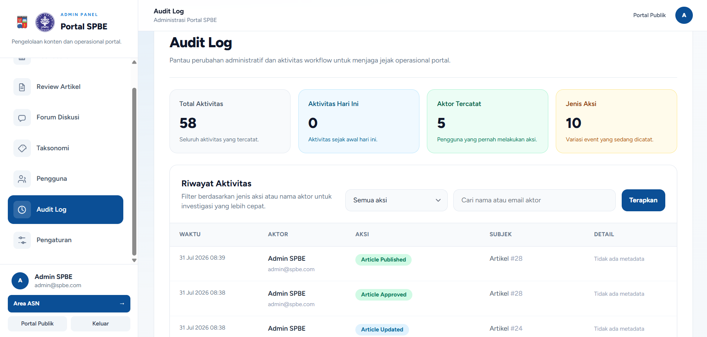
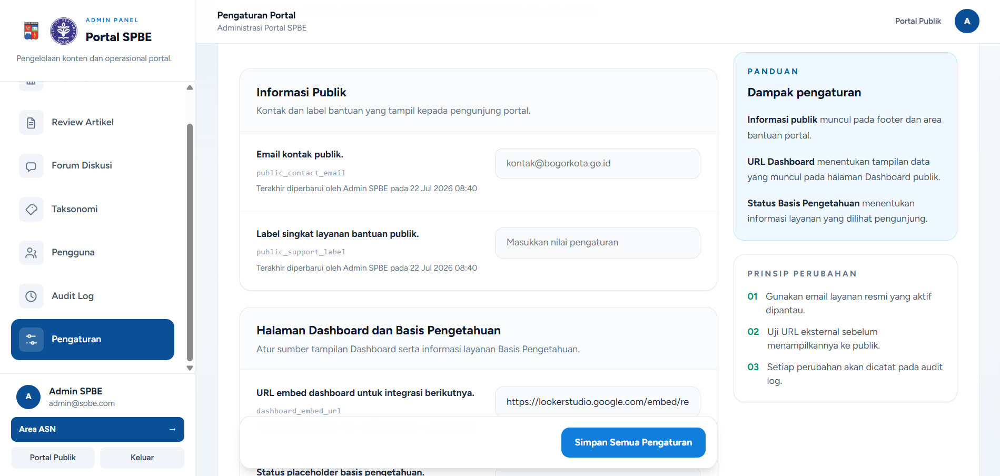

<p align="center">
  
  
</p>

<p align="center">
  <em>An integrated platform for managing publications, community discussions, knowledge bases, regulations, and SPBE performance indicators for Bogor City.</em>
</p>

<p align="center">
  <a href="https://spbe.cibest.id/">
    <strong>🌐 Visit SPBE Portal</strong>
  </a>
</p>

<p align="center">
  
  &nbsp;&nbsp;
  
  &nbsp;&nbsp;
  
  &nbsp;&nbsp;
  
  &nbsp;&nbsp;
  
</p>

# 🌟 Core Features

- **Controlled Editorial Workflow:** Implements a strict governance lifecycle (draft $\rightarrow$ submitted $\rightarrow$ approved $\rightarrow$ published, with a monitored rejected path requiring mandatory admin feedback)
- **Role-Based Access Control (RBAC):** Distinct permissions separating unauthenticated Guests (public browsing and search), internal ASNs (draft creation and submission), and Admins (moderation, publishing, taxonomy, and audit logs)
- **Comprehensive Public Knowledge Portal:** Exposes curated public content including dynamic articles, official regulations, government services, and community discussion forums.
- **Interactive Discussion Moderation:** Enables community knowledge sharing via topic threads and replies with robust administrative controls to activate, deactivate, or purge non-compliant content
- **Taxonomy Management:** Organizes knowledge assets cleanly across dedicated SPBE domains using categories and cross-cutting tags.
- **Scalable Architecture Placeholders:** Includes architectural hooks and placeholders for advanced integrations like Neo4j graph-based knowledge exploration and Looker Studio analytics dashboards.

# 🚀 Key Highlights & Impact Metrics

Engineered to production-grade government standards, SPBE Portal of Bogor City demonstrates robust full-stack software craftsmanship:

- **Strict Separation of Concerns:** Built on a disciplined Laravel MVC monolith ensuring maintainability, rapid feature delivery, and clean architectural boundaries
- **End-to-End Data Integrity:** Validates all state-changing operations through dedicated Form Requests and robust Eloquent ORM relationships.
- **Zero-Tolerance Security & Auditability:** Fully traceable administrative actions via automated audit logging, secure CSRF protection, and centralized authorization policies.
- **Optimized Performance:** Blazing-fast asset compilation and modular frontend interactivity powered by Vite, Tailwind CSS, and Alpine.js.

# 🛠️ Technology Stack & Architectural Rationale

This project bridges a high-performance PHP backend with a responsive, accessible server-rendered interface.

## ⚙️ Backend

- **Laravel:** Chosen for its expressive syntax, out-of-the-box authentication scaffolding, robust routing, and powerful Eloquent ORM
- **PHP** Leverages modern language features, strict typing, and high execution performance.
- **MySQL:** ACID-compliant relational database management supporting complex relational mapping between users, articles, taxonomies, and audit logs

## 💻 Frontend & UI

- **Blade Templates:** Delivers reliable server-side rendering with lightning-fast initial page loads and superior SEO indexing.
- **Tailwind CSS:** Utility-first styling framework ensuring a polished, highly cohesive governmental design system
- **Alpine.js:** Provides lightweight, reactive behavior for dropdowns, modals, and dynamic UI states without heavy SPA overhead.
- **Quill Editor:** Empowers internal contributors with a rich-text editing environment for structured article drafting

## 🛠️ Developer Tooling & Quality Assurance

- **Vite:** Next-generation frontend build tool providing instant hot module replacement (HMR).
- **PHPUnit & Mockery:** Comprehensive feature and unit testing suites ensuring workflow reliability
- **Laravel Pint:** Enforces strict code style consistency across the entire codebase.

# 🔒 Comprehensive Security

Security and accountability were engineered into SPBE Portal from the ground up:

- **Centralized Authorization (Policies & Gates):** Replaces scattered conditional checks with explicit Laravel policies ensuring ASNs can only edit their own drafts and only Admins can publish or moderate.
- **Strict Form Request Validation:** Intercepts and sanitizes all incoming payloads before they touch business logic or persistence layers.
- **Mandatory Rejection Tracking:** Enforces accountability by requiring administrators to provide and store structured notes whenever an article is rejected
- **Audit Trail Logging:** Automatically records critical administrative actions (such as approvals, rejections, publications, and user modifications) with actor metadata and timestamps.

# 📦 Installation & Project Structure

## 🚀 Getting Started

Follow these steps to set up the project locally:

1. **Clone the repository:**

    ```bash
    git clone https://github.com/ahmadsubhand/portal-spbe.git
    cd portal-spbe
    ```

2. **Install PHP dependencies**

    ```bash
    composer install
    ```

3. **Install JavaScript dependencies**

    ```bash
    npm install
    ```

4. **Configure environment variables**

    Copy the example environment file and generate the application key:

    ```bash
    cp .env.example .env
    php artisan key:generate
    ```

    Configure the following environment variables in `.env`:

    - **Database:** Set `DB_CONNECTION` to your database driver (e.g., `mysql` or `pgsql`) and configure the corresponding database credentials (`DB_HOST`, `DB_PORT`, `DB_DATABASE`, `DB_USERNAME`, and `DB_PASSWORD`). The default configuration uses SQLite.
    - **Seeder accounts:** Set `SEED_ADMIN_EMAIL` and `SEED_ADMIN_PASSWORD` for the administrator account, and `SEED_ASN_EMAIL` and `SEED_ASN_PASSWORD` for the ASN account created by the seeders.

    Run the database migrations and seeders to create the database tables and populate the initial data:

    ```bash
    php artisan migrate --seed
    ```

5. **Build assets and start the development server**

    ```bash
    npm run dev
    ```

    In a separate terminal tab:

    ```bash
    php artisan serve
    ```

# 📚 Related Documentation

- [PRD](docs/PRD.md): Original product requirements and MVP scope.
- [Architecture](docs/architecture.md): System design, module workflows, and interface design.
- [Database Schema](docs/database-schema.md): Database table structures, Eloquent relationships, and column data types.
- [Deployment](docs/deployment.md): Step-by-step instructions for production server deployment and asset compilation.
- [Security](docs/security.md): Development security guidelines, authorization, file handling, and auditing.
- [Security Assessment](docs/security-assessment.md): Self-assessment of production release readiness based on the OWASP Top 10.
- [Laravel Documentation](https://laravel.com/docs)
- [Tailwind CSS Documentation](https://tailwindcss.com/docs)
- [Alpine.js Documentation](https://alpinejs.dev/)

# 🖥️ Screenshots

1. Public Homepage


2. Admin Login


3. Admin Dashboard


4. Article Review Queue


5. Forum Moderation


6. Taxonomy Management


7. User Management


8. Audit Trail Logs


9. Portal Settings

