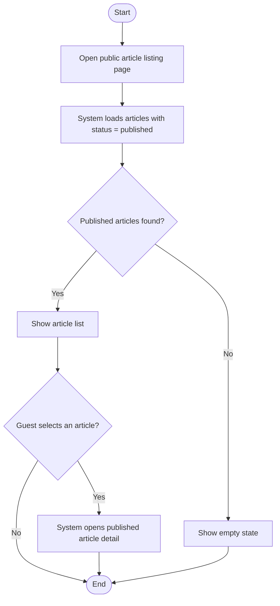
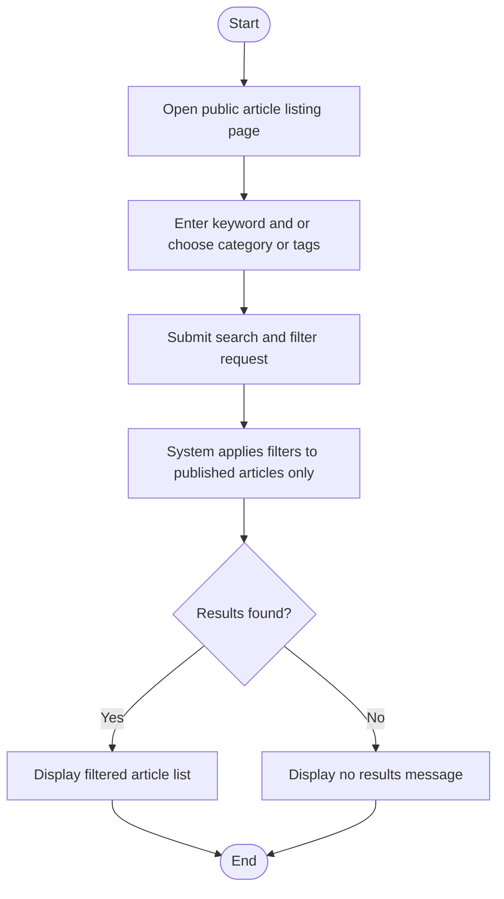
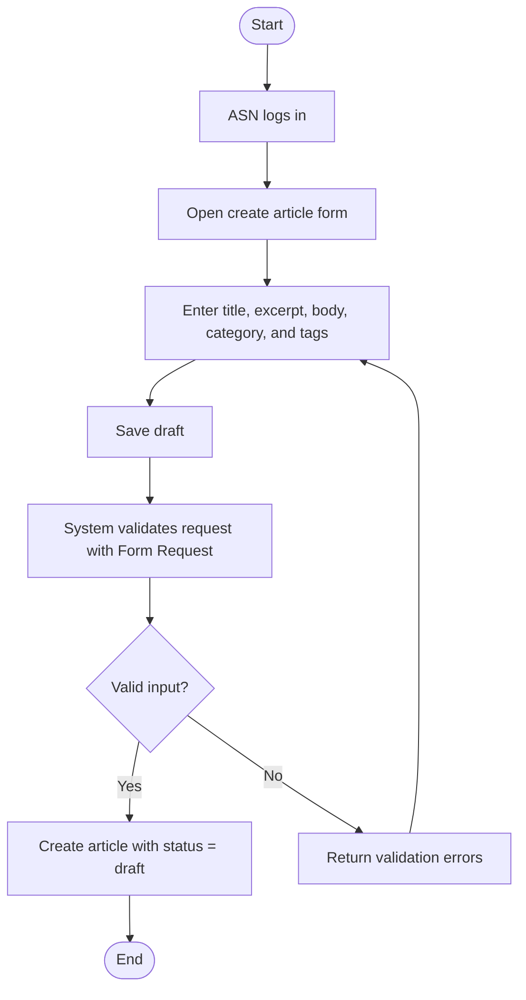
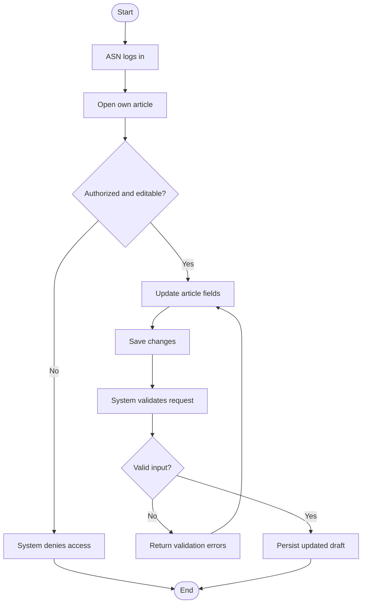
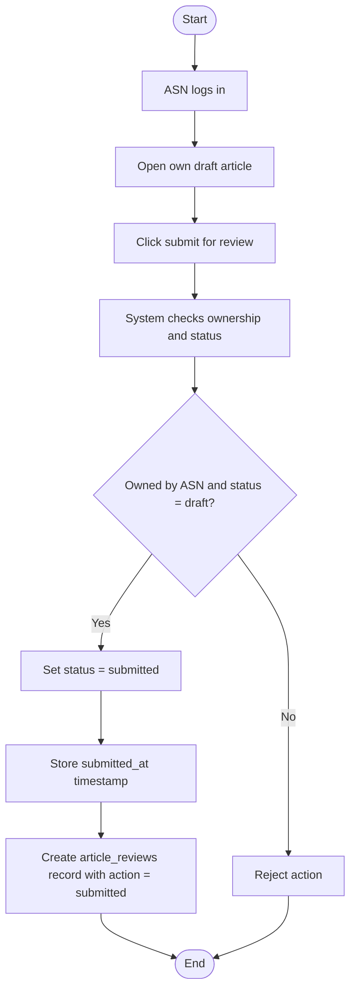
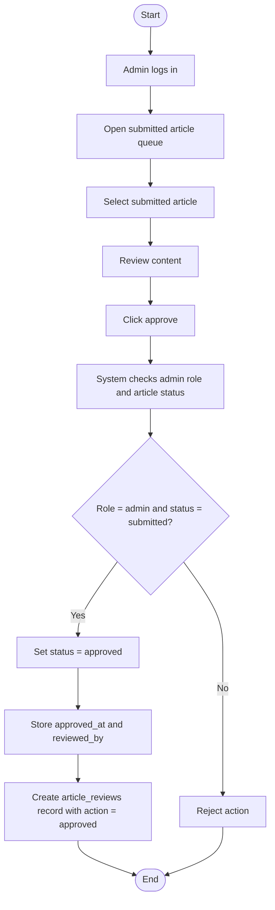
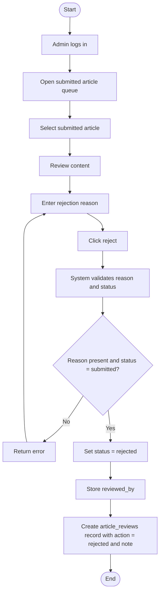
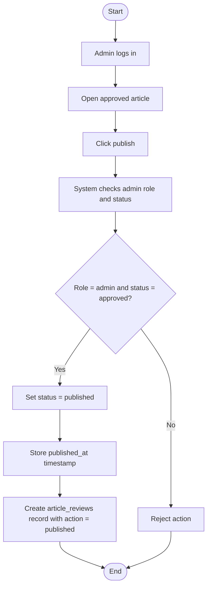
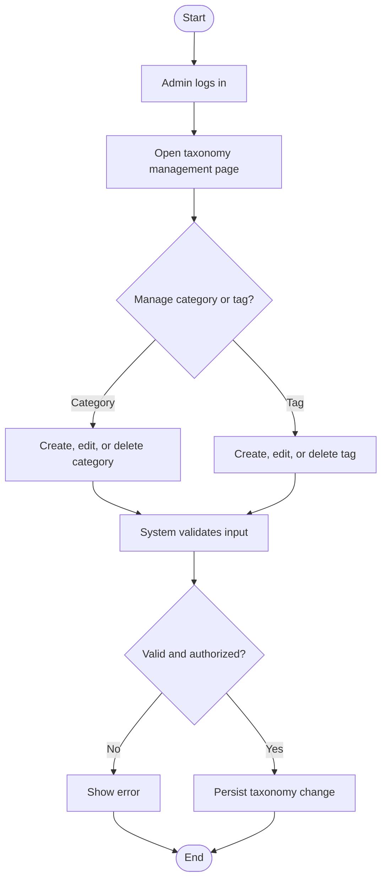
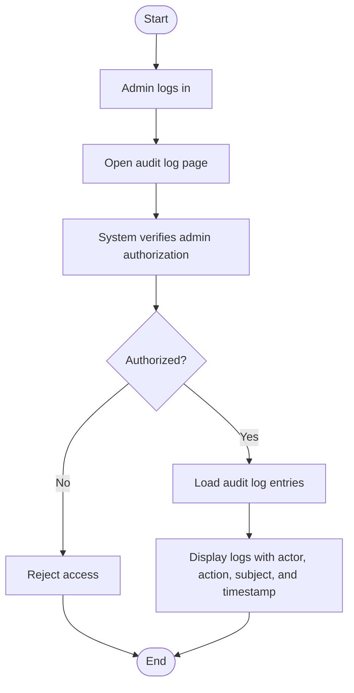

# Activity Diagrams

## Purpose

These diagrams model the key workflows implied by the MVP requirements in the PRD. They focus on the main operational scenarios rather than every minor UI interaction.

## Scenario 1: Guest Browses Published Articles

## Scenario 2: Guest Searches And Filters Articles

## Scenario 3: ASN Creates A Draft Article

## Scenario 4: ASN Edits Own Draft

## Scenario 5: ASN Submits Article For Review

## Scenario 6: Admin Approves Submitted Article

## Scenario 7: Admin Rejects Submitted Article

## Scenario 8: Admin Publishes Approved Article

## Scenario 9: Admin Manages Categories And Tags

## Scenario 10: Admin Views Audit Logs

## Scenario Coverage Notes

- Guest scenarios cover public access and search.
- ASN scenarios cover creation, editing, and submission.
- Admin scenarios cover the full review and publication workflow plus taxonomy and audit operations.
- Public `Regulasi`, `Layanan`, and `Forum Diskusi` pages are inside the approved page scope even if some of them begin as mostly informational/design-driven pages.
- Neo4j and Looker Studio placeholders are intentionally not modeled as separate activity diagrams because, in the MVP, they are simple access pages without business workflow.
- Placeholder intent differs: `Dashboard` is expected to evolve mostly through embed/integration replacement, while `Basis Pengetahuan` is expected to require a larger future feature build.
