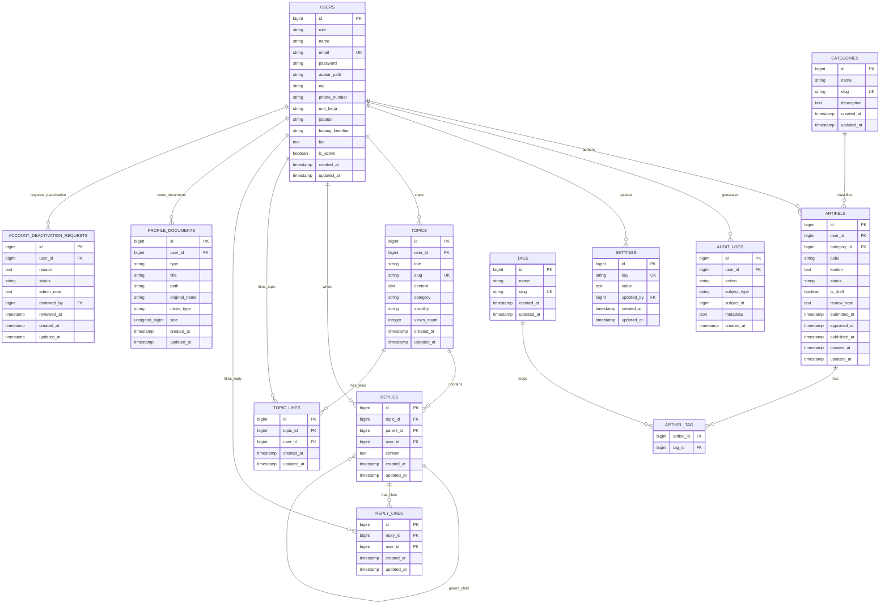

# Database Schema And ERD

## Purpose

This document translates the MVP requirements in [PRD.md](PRD.md) into a practical relational schema for Laravel. It is intentionally scoped to the current MVP and excludes real Neo4j and Looker Studio integration tables.

## Design Notes

- Authorization currently uses a string-based `users.role` column plus policies.
- Artikels belong to one author and can belong to one category.
- Tags are many-to-many with artikels through `artikel_tag`.
- Workflow/admin traceability currently uses `audit_logs`.
- Public visibility is controlled by `status = approved`, `is_draft = false`, and `published_at IS NOT NULL`.
- Forum topic visibility is controlled by `topics.is_active = true` for public exposure, with `visibility` controlling open vs. closed access.
- Placeholder pages are represented in the application layer and do not require dedicated domain tables in the MVP.
- Approved public informational pages such as `Regulasi`, `Layanan`, and the initial `Forum Diskusi` presentation can begin in the application layer without requiring extra domain tables if they are still informational/static in the MVP slice.

## Core Tables

### `users`

- `id`
- `role` (`admin`, `asn`, `guest`)
- `name`
- `email`
- `password`
- `avatar_path` (nullable, public profile avatar storage path)
- `nip` (nullable, unique 18-digit portal profile identifier)
- `phone_number` (nullable)
- `unit_kerja` (nullable)
- `jabatan` (nullable)
- `bidang_keahlian` (nullable)
- `bio` (nullable)
- `is_active`
- `created_at`
- `updated_at`

### `categories`

- `id`
- `name`
- `slug`
- `description`
- `created_by`
- `updated_by`
- `created_at`
- `updated_at`

### `tags`

- `id`
- `name`
- `slug`
- `created_by`
- `updated_by`
- `created_at`
- `updated_at`

### `artikels`

- `id`
- `user_id`
- `category_id`
- `judul`
- `konten`
- `status`
- `is_draft`
- `review_note`
- `submitted_at`
- `approved_at`
- `published_at`
- `created_at`
- `updated_at`

Current status values:

- `pending`
- `approved`
- `rejected`

Note:

- Draft state is represented by `is_draft = true`
- Submitted state is represented by `status = pending` and `is_draft = false`
- Published state is represented by `status = approved` and `published_at != null`
- Unpublishing preserves the approved article and clears `published_at`.

### `artikel_tag`

- `artikel_id`
- `tag_id`

### `audit_logs`

- `id`
- `user_id`
- `action`
- `subject_type`
- `subject_id`
- `metadata`
- `created_at`

This supports the PRD requirement for admin-accessible audit logs.

## Application-Layer Public Pages

The approved Figma includes public pages for:

- `Regulasi`
- `Layanan`
- `Forum Diskusi`
- `Basis Pengetahuan`
- `Dashboard`

Database note:

- `Artikel` is expected to be backed by the article workflow domain.
- Public design-driven sections may start without dedicated tables, but should move to real managed data when they become operational modules.
- `Dashboard` may remain an integration-oriented placeholder initially because its likely next step is an embed/configuration integration rather than a full relational module.
- `Basis Pengetahuan` may remain a future-feature placeholder initially because its likely next step is a larger graph-backed implementation rather than a simple table-backed replacement.
- `Regulasi`, `Layanan`, and `Forum Diskusi` do not require dedicated tables yet unless their content is promoted from static/design-driven content into managed records.

### `settings`

- `id`
- `key`
- `value`
- `updated_by`
- `created_at`
- `updated_at`

## ERD

## Relationship Summary

- One user can author many articles.
- One category can contain many articles.
- One article can have many tags through `artikel_tag`.
- One user can generate many audit log records.
- One user can start many forum topics.
- Active forum topics use `topics.is_active = true`; inactive topics are retained but excluded from public queries and interactions.
- One user can write many forum replies.
- Active replies use `replies.is_active = true`; inactive replies are retained but excluded from public threads and reply interaction endpoints.
- One user can like many forum topics or replies.
- One user can own many profile documents.
- One user can submit many account deactivation requests.

## Laravel Modeling Guidance

- `User` hasMany `Artikel`
- `Artikel` belongsTo `User` as author
- `Artikel` belongsTo `Category`
- `Artikel` belongsToMany `Tag`
- `Category` hasMany `Artikel`
- `Tag` belongsToMany `Artikel`
- `User` hasMany `Topic`
- `User` hasMany `Reply`
- `Topic` belongsTo `User`
- `Topic` hasMany `Reply`
- `Reply` belongsTo `Topic`
- `Reply` belongsTo `User`
- `Reply` hasMany `Reply` as children (referencing `parent_id`)
- `User` hasMany `ProfileDocument`
- `ProfileDocument` belongsTo `User`
- `User` hasMany `AccountDeactivationRequest`
- `AccountDeactivationRequest` belongsTo `User`

## Constraints To Enforce In Code

- Only `published` articles are queryable in public routes.
- Only article owners can edit their own drafts and rejected articles, depending on policy rules.
- Only Admin can approve, reject, publish, and manage taxonomy.
- Rejection must require a non-empty review note.
- Submission should only be allowed from `draft`.
- Publish should only be allowed from `approved`.

# Account Deactivation Requests

`account_deactivation_requests` stores user-submitted account deactivation requests. Admin approval sets `users.is_active` to `false`; it does not delete the user, articles, forum topics, or audit history.

# Profile Documents

`profile_documents` stores metadata for optional professional supporting documents. Files are stored privately outside `public/storage`; access is limited to the document owner.

Allowed categories are competency certificates, training certificates, assignment letters, and other relevant supporting documents. Sensitive identity documents such as KTP are outside the portal scope.
