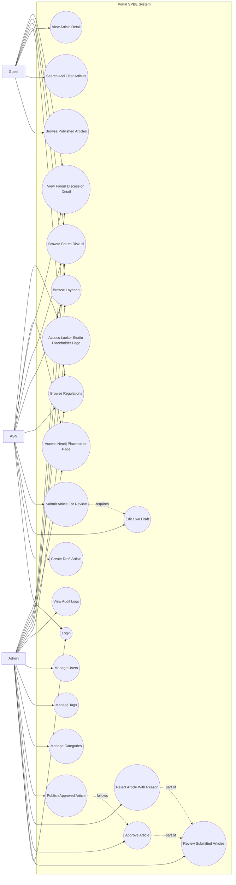

# Use Case Diagram

## Purpose

This diagram captures the main interactions between the three actors defined in the PRD: `Guest`, `ASN`, and `Admin`.

## Diagram

## Scope Notes

- `Guest` is not modeled as a persisted user record.
- `Login` applies to authenticated internal users, especially ASN and Admin.
- Public `Regulasi`, `Layanan`, and `Forum Diskusi` pages are included because they are part of the approved initial design scope.
- Placeholder page access is included because it is explicitly in MVP scope, even though external integrations are not.
- `Dashboard` is treated as an integration-oriented placeholder, while `Basis Pengetahuan` is treated as a future-feature placeholder.
- Review, approval, rejection, and publishing are separated because the PRD treats them as distinct workflow actions with different rules.
